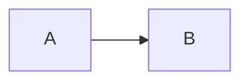

# Code blocks

```js
// greet once
const greeting = "hello";
function greet(times) { return greeting.repeat(times + 1); }
```

```json
{ "name": "viz", "count": 3 }
```

```
plain block without a language
```

```html

```


