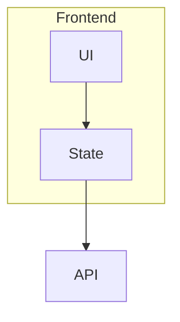

# Diagram edge cases

A valid flowchart with a subgraph:



A truncated flowchart:

```mermaid
graph TD
 A -->
```

Text that is not a diagram:

```mermaid
hello world
```

The page keeps going after the broken fences.
