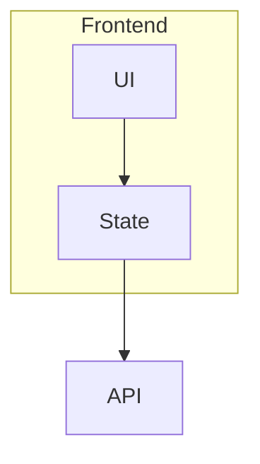
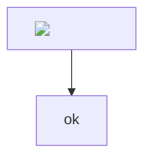
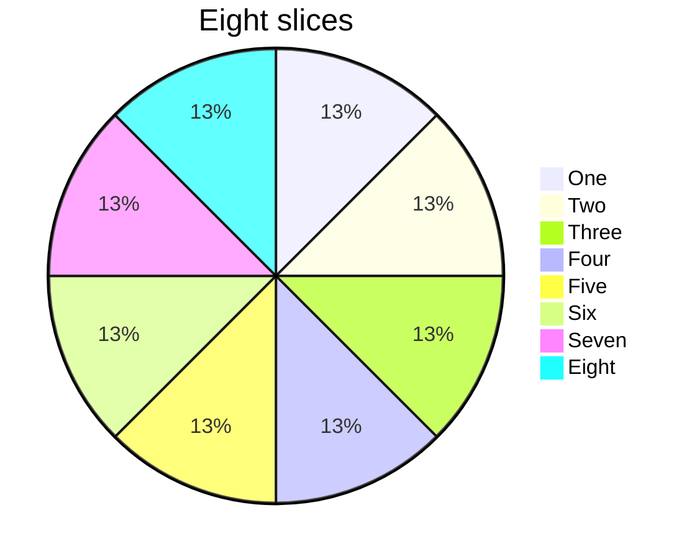

# Diagram edge cases

A valid flowchart with a subgraph:



A truncated flowchart:

```mermaid
graph TD
 A -->
```

Text that is not a diagram:

```mermaid
hello world
```

A hostile label is drawn as text:



A broken diagram with a hostile token:

```mermaid
graph TD
    A --> 
```

An eight-slice pie:



The page keeps going after the broken fences.
