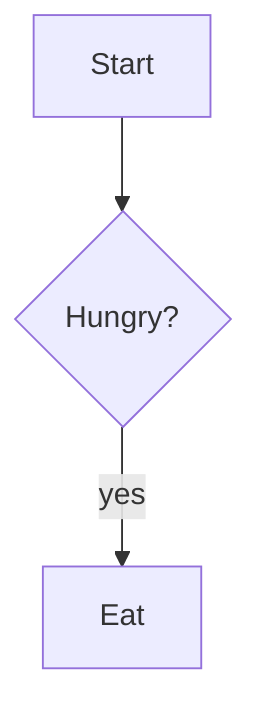

## What for lunch?

| Option | Upside | Cost | Cost to reverse |
|---|---|---|---|
| Bento | Cheap; fast | Greasy | Low |
| Ramen | Tasty; hot | Queue; salty | Medium |
| Salad | Refreshing | Not filling | Low |

## Flow



## Broken diagram

```mermaid
graph TD
    A -->
```
